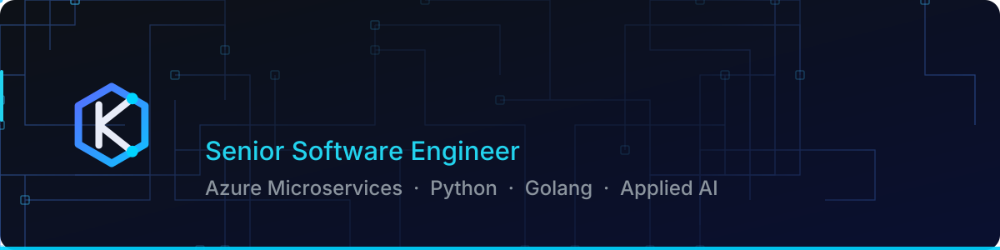

<picture>
  <source media="(prefers-color-scheme: dark)" srcset="assets/banner-dark.svg">
  
</picture>

<div align="center">

# Obaid Ullah Khan

### Senior Software Engineer · Secure cloud backends · AI chatbots & RAG
**Python · C# / .NET · Go · Azure · Google Cloud** · Islamabad, Pakistan 🇵🇰 · Open to remote work and relocation

[](https://obaidullahkhankhail.netlify.app/)
[](https://www.linkedin.com/in/obaidullahkhankhail/)
[](https://obaidullahkhankhail.netlify.app/#contact)
[](https://obaidullahkhankhail.netlify.app/assets/docs/Obaid-Ullah-Khan-CV.pdf)

[](https://www.credly.com/users/obaid-ullah-khan.6b35b0c9)
[](https://www.skills.google/public_profiles/eea4377c-19bd-4d8c-99d3-d665bdd45f95)
[](https://ieeexplore.ieee.org/document/10899344)

</div>

---

## At a glance

| | |
| --- | --- |
| **Role** | Senior Software Engineer at [TEO International](https://www.teo-intl.com/) (since April 2022) |
| **Experience** | 5+ years in software engineering, backend developer on 3 production products |
| **Location** | Islamabad, Pakistan (UTC+5), open to remote and relocation |
| **Specialities** | Secure application development · microservices and APIs · cloud (Azure, Google Cloud) · AI chatbots and RAG |
| **Main languages** | Python, C# (.NET 8), Go, with Next.js and TypeScript in progress |
| **Certified** | Google Cloud Generative AI Leader · Associate Cloud Engineer · Cloud Digital Leader |
| **Published** | IEEE TechDev 2024, NLP code-reuse recommendation with BERT and CodeBERT |
| **Contact** | [Portfolio form](https://obaidullahkhankhail.netlify.app/#contact) · [LinkedIn](https://www.linkedin.com/in/obaidullahkhankhail/) |

## About

I build **secure, scalable cloud backends** and put **AI to work inside them**. At TEO International I have been a backend developer on three production products: a live mosque platform, an asset-tracking cloud platform and a healthcare AI platform.

- 🔒 **Secure by design.** Authentication and authorization, input validation, secrets management and security-minded code review, following the OWASP Top 10.
- 🏗️ **Backends that scale.** Hexagonal microservices in **C# 12 / .NET 8**, plus **Python** and **Go** services over REST, gRPC and WebSocket, on **Azure** with CI/CD.
- 🤖 **Applied AI.** Chatbots and **RAG** (embeddings, vector search, grounded answers with citations), AI agents and document automation with Azure AI.
- ✅ **Quality.** Unit tests, code reviews, CI/CD and monitoring, using AI tools to generate tests and catch issues earlier.
- 📚 **Learning now.** Next.js and TypeScript.

> Client work is described at a high level only, to respect confidentiality.

## Tech stack

<div align="center">


</div>

| Area | What I use |
| --- | --- |
| **Languages** | Python, C#, Go, TypeScript, C++, Dart, Java, MATLAB |
| **Backend & APIs** | .NET 8, FastAPI, Gin, REST, gRPC, WebSocket, OpenAPI, Hexagonal Architecture, microservices |
| **Cloud** | Azure (Storage, Cosmos DB, AD B2C, API Management, Application Insights), Google Cloud, Terraform |
| **AI** | Chatbots, RAG, vector search, AI agents (Google ADK), Azure AI Document Intelligence, Azure Vision AI, TensorFlow Lite, BERT, CodeBERT |
| **Security** | Secure API design, OWASP Top 10, Azure AD B2C, API gateway protection, secrets management, security-minded code review |
| **DevOps & data** | Docker, Git, CI/CD (Azure DevOps), Cosmos DB, MongoDB, MySQL, Redis, Firebase |

## Featured work

| Project | What it is |
| --- | --- |
| **[My-Masjid](https://my-masjid.com/)** | Live mosque platform. Backend services, onboarding automation (Azure Vision AI and Document Intelligence) and the visual themes for the web and mobile apps. |
| **Healthcare AI platform** | Backend developer on a client platform with AI-assisted documentation. Details are generic to protect confidentiality. |
| **Asset-tracking cloud platform** | Backend work and Azure DevOps CI/CD on a client cloud platform (high level). |
| **Go e-commerce backend** | gRPC microservices and REST APIs (Gin) with MySQL, Firebase and Redis, containerised with Docker and documented with OpenAPI. |
| **Code re-use recommendation** | Python NLP system with BERT and CodeBERT, [published at IEEE TechDev 2024](https://ieeexplore.ieee.org/document/10899344). |

Full case studies, a live RAG demo and a showreel are on the **[portfolio](https://obaidullahkhankhail.netlify.app/)**.

## Experience

| Period | Role | Where |
| :-- | :-- | :-- |
| **Apr 2022 to present** | Senior Software Engineer | [TEO International](https://www.teo-intl.com/) |
| 2022 | Freelance Developer (Android OCR and object detection apps) | Freelance |
| Dec 2021 to Mar 2022 | Internee (SEO, social media, UX) | [Esajee's](https://esajee.com/) |
| Sep 2020 to Oct 2020 | Internee (PLC basics, digital marketing) | [Research Teck](https://researchteck.org/) |

**Education:** BSCS, [Bahria University Islamabad](https://bahria.edu.pk/) (Feb 2022).

## Certifications

[](https://www.credly.com/badges/5a905ac3-52ea-448a-9f72-1e068fb28852/public_url)
[](https://www.credly.com/badges/8b0538e8-dc25-4567-8c6b-6833847b5118/public_url)
[](https://www.credly.com/badges/a0e9f396-2c7b-41a5-94c7-2e2a482130b5/public_url)

Hands-on skill badges include Cloud Security Fundamentals, Terraform on Google Cloud, Cloud Run, load balancing, GKE cost optimisation and the Agent Development Kit (ADK). All badges: [Credly](https://www.credly.com/users/obaid-ullah-khan.6b35b0c9) · [Google Skills](https://www.skills.google/public_profiles/eea4377c-19bd-4d8c-99d3-d665bdd45f95)

## How I build

```text
 understand  ->  design  ->  build  ->  secure & test  ->  ship  ->  monitor
 (map data      (hexagonal  (Python, C#,  (OWASP checks,   (CI/CD    (Application
  and flows)     services)   Go APIs)      unit tests,      on Azure)  Insights)
                                          code review)
```

## GitHub activity

<div align="center">

| Right now | |
|:--|:--|
| 📍 Based in | Islamabad, Pakistan (UTC+5) |
| 🛠️ Building | Secure cloud backends and applied AI (RAG, agents) |
| 🧰 Daily stack | Python · Go · C#/.NET · Azure |
| 🤝 Open to | Senior backend / AI engineering roles and select freelance work |
| ✉️ Reach me | [Portfolio contact form](https://obaidullahkhankhail.netlify.app/#contact) |


</div>

<picture>
  <source media="(prefers-color-scheme: dark)" srcset="https://raw.githubusercontent.com/OBAIDULLAHKHANKHAIL/OBAIDULLAHKHANKHAIL/output/snake-dark.svg">
  
</picture>

## Frequently asked questions

<details>
<summary><b>Who is Obaid Ullah Khan?</b></summary>

Obaid Ullah Khan is a Senior Software Engineer in Islamabad, Pakistan with 5+ years of experience building secure cloud backends and AI-powered products with Python, C#/.NET, Go and Azure. He works at TEO International and has been a backend developer on three production products.
</details>

<details>
<summary><b>Can he build AI chatbots and RAG systems?</b></summary>

Yes. He builds retrieval-augmented generation (RAG) chatbots that answer from a company's own documents, using embeddings, vector search, source citations, guardrails and evaluation. He also automates document-heavy workflows with Azure AI.
</details>

<details>
<summary><b>Does he develop secure applications?</b></summary>

Yes. He designs for security from the start: authentication and authorization with Azure AD B2C, secure API design against the OWASP Top 10, input validation, secrets management and security-minded code review.
</details>

<details>
<summary><b>What technologies does he use?</b></summary>

Python, C# with .NET 8, Go and TypeScript; Azure and Google Cloud; microservices with REST, gRPC and WebSocket; Cosmos DB, MongoDB, MySQL and Redis; Docker, Terraform and CI/CD. He is learning Next.js.
</details>

<details>
<summary><b>Is he available for hire?</b></summary>

Yes, for senior backend, cloud and applied-AI roles and projects, remote or with relocation. Reach him through the [portfolio contact form](https://obaidullahkhankhail.netlify.app/#contact) or [LinkedIn](https://www.linkedin.com/in/obaidullahkhankhail/).
</details>

<details>
<summary><b>What certifications does he hold?</b></summary>

Google Cloud Generative AI Leader, Google Cloud Associate Cloud Engineer and Google Cloud Cloud Digital Leader, plus 18 Google Skills badges. All are verifiable on [Credly](https://www.credly.com/users/obaid-ullah-khan.6b35b0c9).
</details>

---

<div align="center">

### Let's build something reliable.

[](https://obaidullahkhankhail.netlify.app/#contact)

</div>

<!--
  Search keywords: senior software engineer Islamabad Pakistan, Python developer, .NET developer, C# developer, Golang developer,
  Azure developer, backend developer, microservices, gRPC, REST API, secure application development, OWASP, AI engineer,
  RAG chatbot developer, generative AI, Azure AI, Google Cloud certified, Next.js, remote software engineer, hire.
-->
